# playboard-report

**Dashboard local para analizar el histórico de tus reportes de Playwright** y tener a mano la documentación de tu suite de tests. Modo oscuro por defecto (y claro) e interfaz en castellano o inglés.

El reporte HTML de Playwright es muy completo, pero solo muestra una ejecución. playboard-report junta todos tus reportes y te enseña cómo evolucionan por **día, semana, mes y año**: qué tests fallan más, cuáles son flaky, qué errores se repiten, qué se ha roto o arreglado desde la ejecución anterior y cuánto duran las ejecuciones. Además tiene un visor para tus notas en Markdown.

**Pruébalo sin instalar nada:** la [versión web](https://danico9.github.io/playboard-report/) funciona en el navegador con los datos de ejemplo o con tu carpeta de reportes, que se lee desde tu navegador sin subirse a ningún sitio (ver [Versión web](#versión-web-en-el-navegador)).

> *English summary:* a local dashboard (dark mode by default, light mode available; UI in Spanish or English) that aggregates many Playwright HTML reports over time (day/week/month/year views, flaky and failing tests, grouped errors, per-module health) plus a Markdown notes viewer. The UI can be switched between Spanish and English. Your reports and notes stay on your machine and are git-ignored. There is also a [web version](https://danico9.github.io/playboard-report/) that reads your reports folder from the browser, without uploading anything.

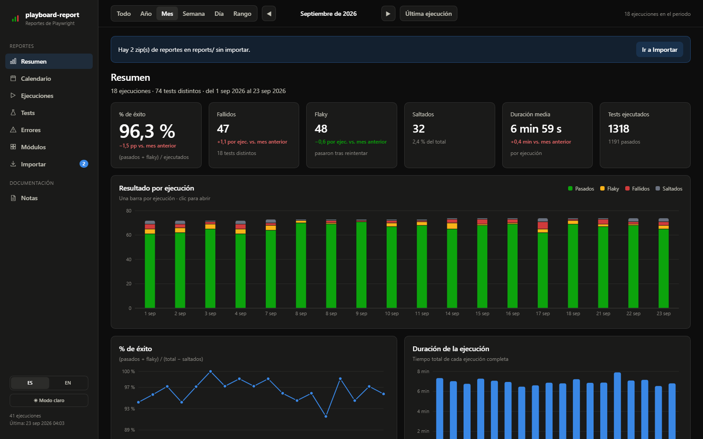

<details>
<summary><b>Más capturas</b> (generadas con los datos de demostración, <code>npm run demo</code>)</summary>

| | |
|---|---|
| 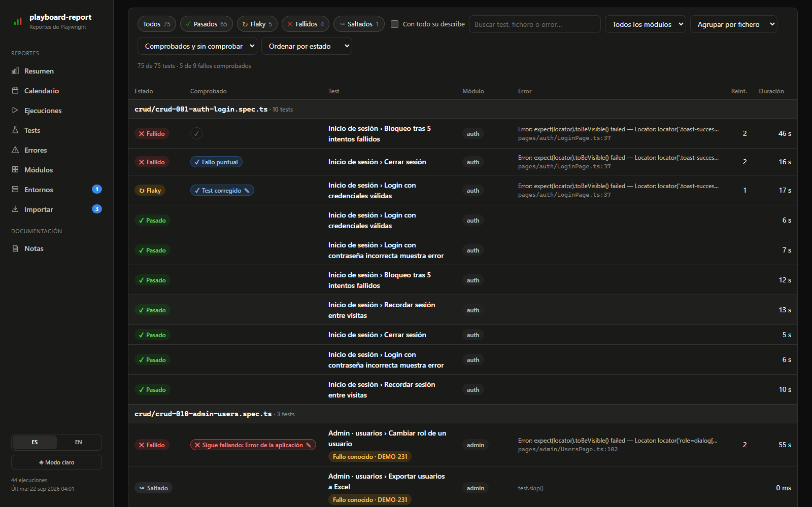 | 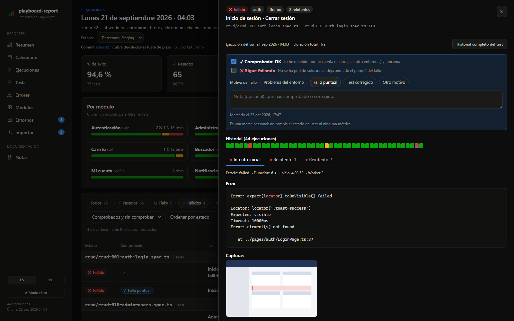 |
| **Ejecución**: tests con su estado, error y marca «Comprobado» | **Test de una ejecución**: marca de comprobado, error, capturas y reintentos |
| 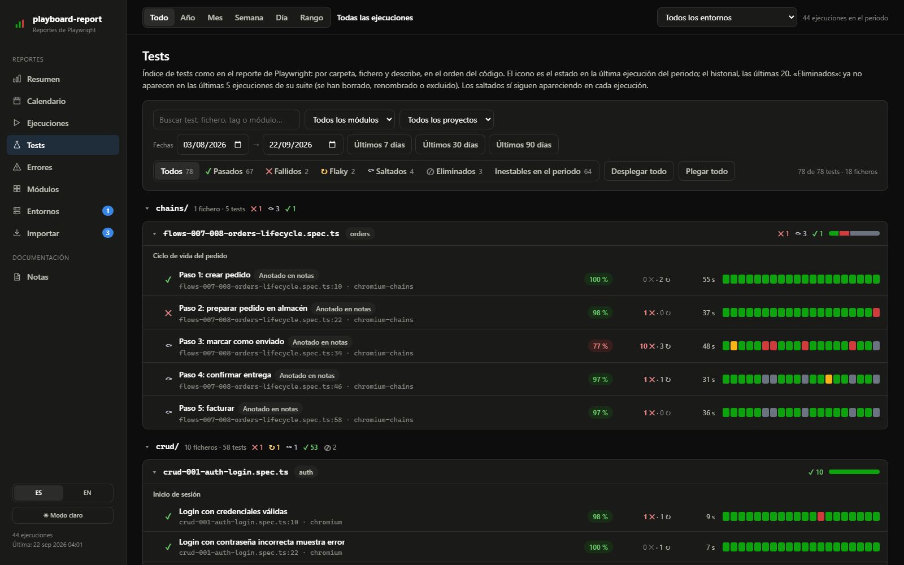 | 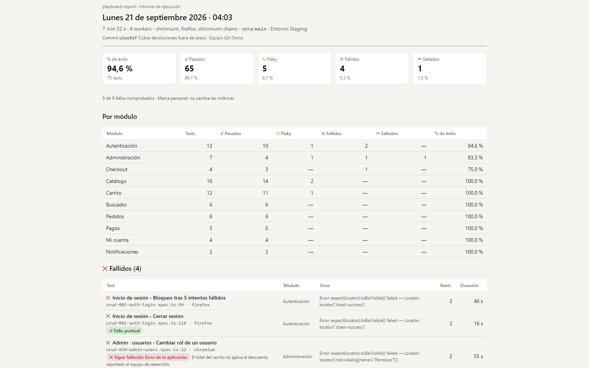 |
| **Tests**: índice como el reporte de Playwright, con su historial | **Informe / PDF** de una ejecución |
| 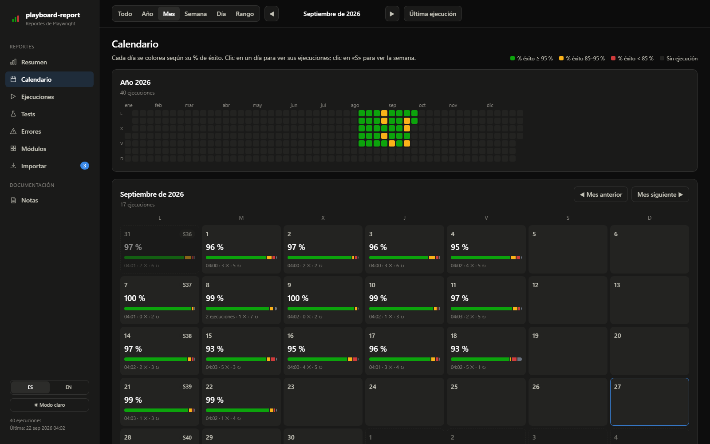 | 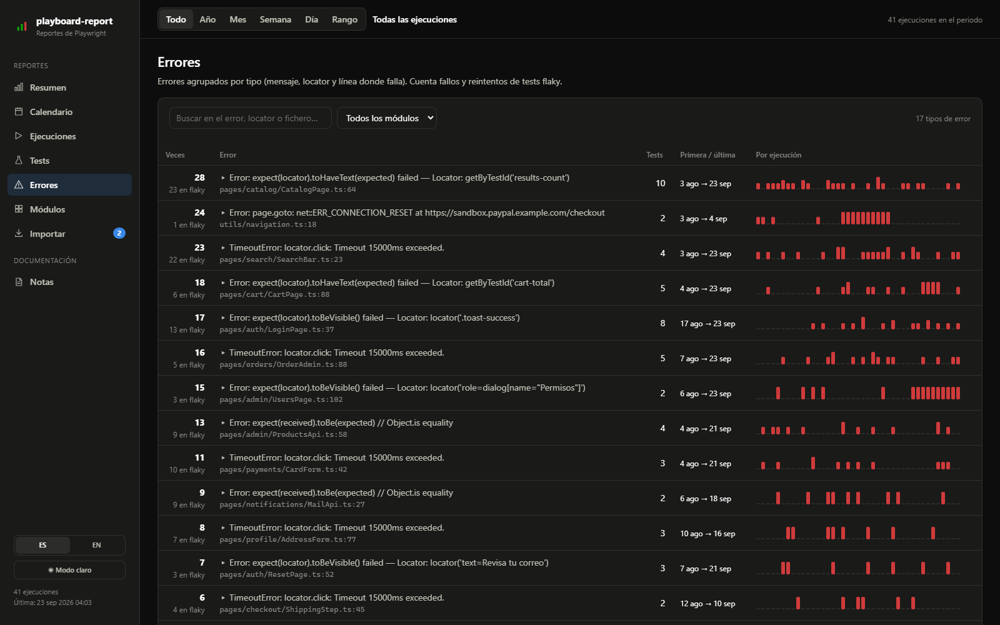 |
| **Calendario** | **Errores** agrupados |
| 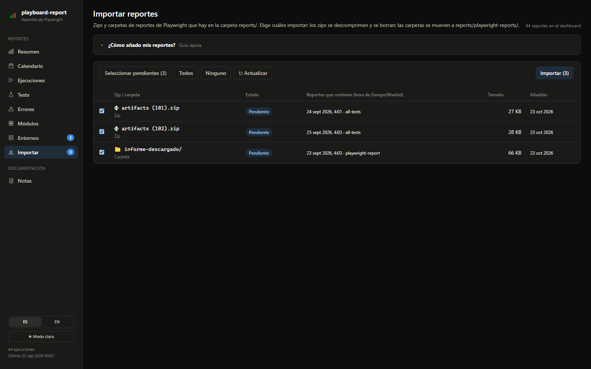 | 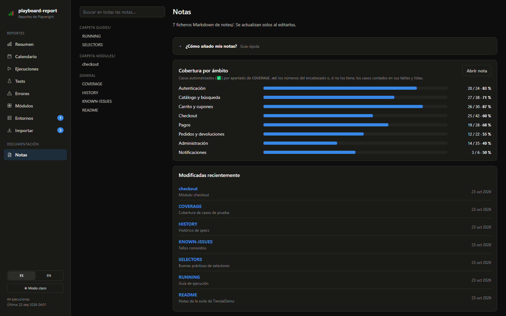 |
| **Importar** zips del CI | **Notas** en Markdown |
| 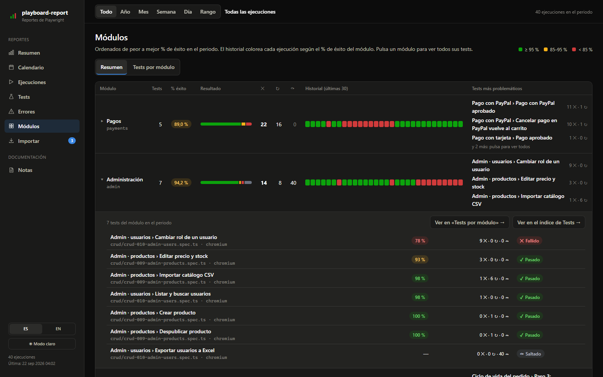 | 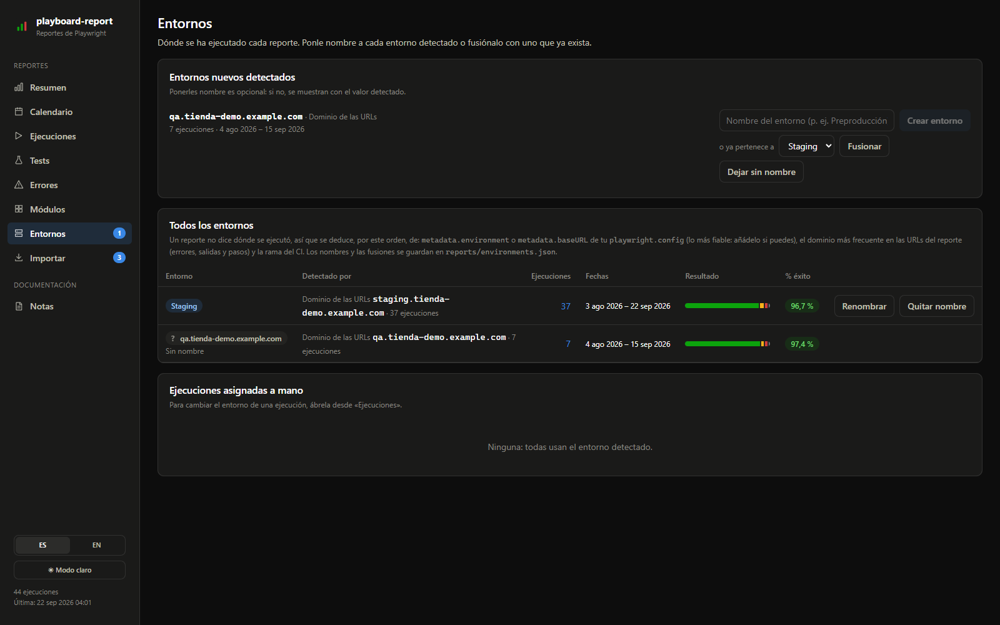 |
| **Módulos**: salud de cada área y todos sus tests | **Entornos**: ponles nombre o fusiónalos |
| 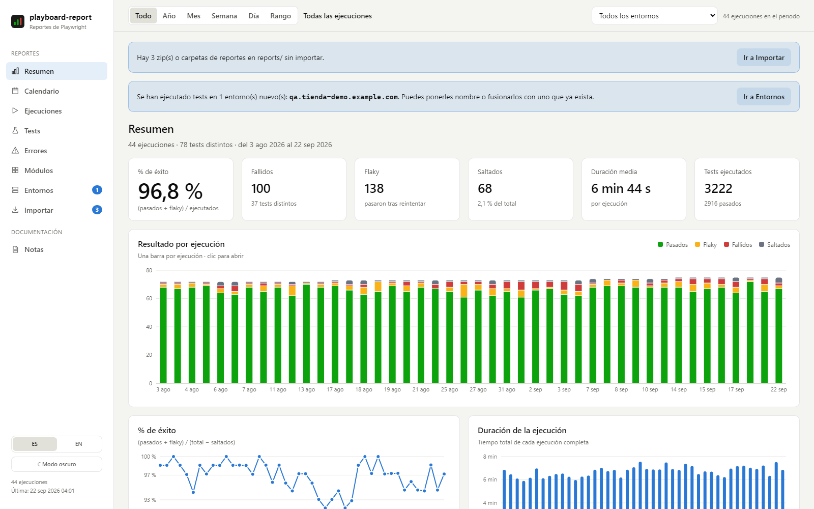 | 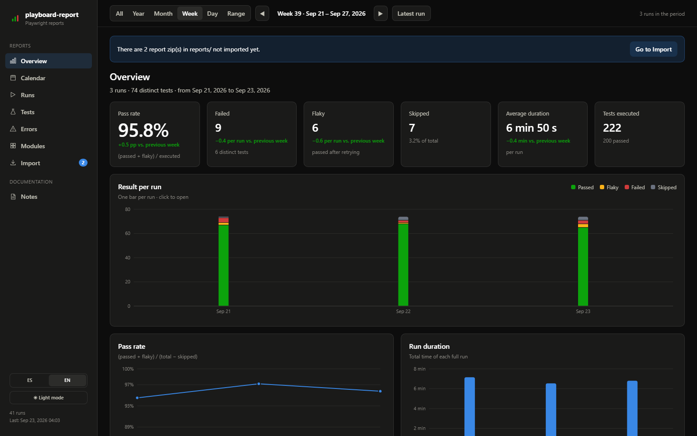 |
| **Modo claro** | **Interfaz en inglés** |
| 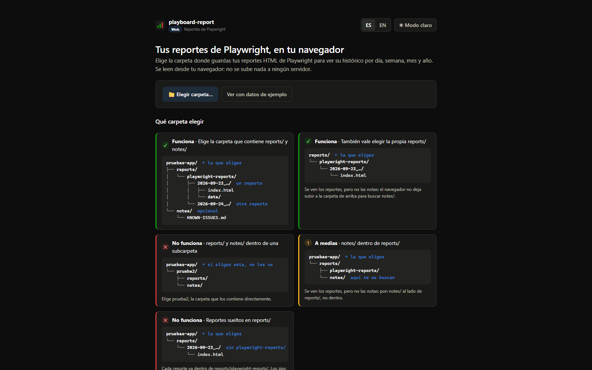 | 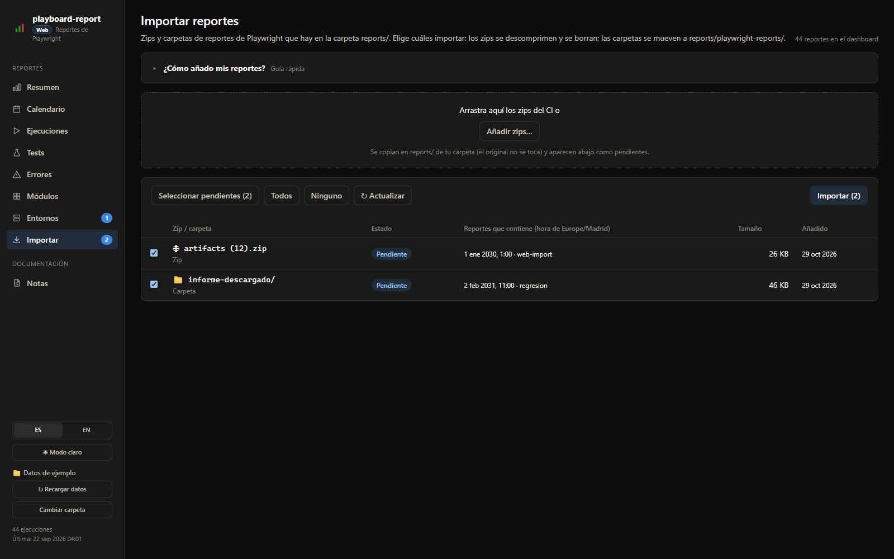 |
| **Versión web**: elige tu carpeta o mira los datos de ejemplo | **Importar** en la versión web, con «Añadir zips…» |

</details>

---

## Características

- **Resumen del periodo:** % de éxito, fallidos, flaky, saltados y duración media, comparados con el periodo anterior. Gráficas por ejecución.
  - Listas de fallos nuevos, tests arreglados y tests nuevos.
  - Rankings: los que más fallan, los más flaky y los más lentos.
- **Selector de periodo común a todas las pantallas:** Todo, Año, Mes, Semana, Día o un Rango de fechas. El periodo va en la URL, así que puedes guardar o compartir la vista.
- **Entornos:** si tus tests se ejecutan en varios entornos (p. ej. preproducción y test), la app los detecta y te avisa del nuevo. Puedes ponerle el nombre que quieras, fusionarlo con un entorno que ya exista o dejarlo sin nombre.
  - Se detecta, por este orden, por `metadata.environment` o `metadata.baseURL` del `playwright.config` (lo más fiable), el dominio más frecuente en las URLs del reporte (errores, salidas y pasos) o la rama del CI. Las ejecuciones sin nada de esto salen como «Sin detectar».
  - Todas las pantallas se pueden filtrar por entorno (el selector aparece junto al periodo), y los fallos nuevos y arreglados se calculan contra la ejecución anterior **del mismo entorno**.
  - Desde el detalle de una ejecución puedes cambiar su entorno a mano. Los nombres, las fusiones y las asignaciones se guardan en `reports/environments.json`.
- **Calendario:** heatmap anual y calendario mensual, con cada día coloreado según su % de éxito.
- **Detalle de ejecución:** desglose por módulo y lista de tests con filtros (el botón **Todos** marca a la vez pasados, flaky, fallidos y saltados) y agrupación (con la opción **Con todo su describe**, como en Tests). Cada test abre un panel con:
  - el error con sus colores, las capturas, el vídeo (con controles para adelantar y atrasar), el contexto del error y el stdout;
  - el botón **Abrir trace**, que abre la traza en el visor de Playwright que va dentro del propio reporte (también se puede descargar; en la versión web se abre en el visor de Playwright publicado junto a la web);
  - los reintentos y su historial en todas las ejecuciones.
- **Informe / PDF de una ejecución:** el botón **Informe / PDF** del detalle de una ejecución abre un informe para imprimir o guardar como PDF (con «Guardar como PDF» en la ventana de impresión del navegador).
  - Los **fallidos** salen en una tabla: test, fichero y proyecto, módulo, error, reintentos, duración, fallos conocidos y la marca «Comprobado: OK» o «Sigue fallando» con su motivo y nota.
  - Los **flaky**, **pasados** y **saltados** salen en listas compactas por fichero (a dos columnas, con el icono de su estado), para que el informe no se alargue aunque haya muchos tests.
  - Se puede limitar a un módulo, elegir si incluir los pasados y los saltados e imprimirlo en modo **claro** u **oscuro**.
- **Fallos comprobados («Comprobado: OK»):** junto a cada test fallido o flaky de una ejecución hay una columna para marcarlo como comprobado, por ejemplo después de repetirlo en local y ver que pasa.
  - En el panel del test puedes añadir el motivo (problema del entorno, fallo puntual, test corregido u otro) y una nota.
  - Si no se ha podido solucionar, márcalo en el panel como **Sigue fallando** (en rojo) y deja anotado el porqué: motivo (problema del entorno, error de la aplicación, error del propio test u otro) y nota.
  - Es una marca **solo para ti**: no cambia el estado del test ni ninguna métrica. Se ve en la lista de la ejecución (con un filtro «Sin comprobar» / «Comprobados: OK» / «Sigue fallando»), en el historial del test y en sus cuadrados de colores.
  - Se guarda en `reports/reviews.json`.
- **Tests:** índice de todos los tests como en el reporte de Playwright (carpeta → fichero → `describe` → test, en el orden del código), pero con los datos de todo el periodo.
  - Cada test muestra su estado en la última ejecución, su % de éxito, fallos, flaky, duración media y una fila de cuadrados de colores, uno por ejecución.
  - Filtros por estado con contadores (como en Playwright), «Eliminados» e «Inestables en el periodo», buscador (test, fichero, tag o módulo), módulo, proyecto y rango de fechas con atajos (últimos 7, 30 o 90 días).
  - **Con todo su describe:** al filtrar por un estado (p. ej. Fallidos), muestra también, atenuados, los demás tests del mismo describe en cualquier estado: útil cuando el describe es el test y lo de dentro son sus pasos.
  - Carpetas y ficheros se pliegan y despliegan. Los filtros van en la URL: se conservan al abrir un test y volver atrás.
  - **Tests eliminados:** un test que no aparece en las últimas 5 ejecuciones de su suite se marca como **Eliminado** (se ha borrado, renombrado o excluido).
    No se confunde con un test saltado: los saltados siguen apareciendo en cada reporte. Las ejecuciones parciales (de otra suite, p. ej. de un solo spec) no cuentan.
    Se marcan en Tests, Módulos, Errores y la ficha del test, y el número de ejecuciones se cambia en `REMOVED_AFTER_RUNS` (`src/config/status.js`).
- **Errores:** agrupados por tipo (mensaje, locator y línea donde falla), con los tests afectados y su evolución. Cada test suma una vez por ejecución en la que falla o es flaky. Dos pestañas:
  - **Del periodo:** los errores del periodo elegido. Se marcan como **Nuevo** los que no habían salido nunca antes del periodo.
  - **Histórico:** todos los errores de todas las ejecuciones, sin tener en cuenta el periodo.
  - En ambas se marcan como **Ya no aparece** los errores cuyos tests afectados se han vuelto a ejecutar después (o se han eliminado) y no lo han repetido. Si alguno no se ha ejecutado desde entonces, el error sigue contando como activo. Se puede filtrar por estado (nuevos, siguen apareciendo, ya no aparecen).
- **Módulos:** dos pestañas.
  - **Resumen:** % de éxito por área funcional y sus tests más problemáticos. Al pulsar un módulo se despliegan todos sus tests.
  - **Tests por módulo:** tabla de estadísticas de cada test, agrupada por módulo o por fichero (o en lista), ordenable por columnas.
- **Listas paginadas:** Tests, «Tests por módulo», Errores, Ejecuciones, el detalle de una ejecución y el historial de un test se muestran por páginas (50, 100, 250 o 500 elementos; el tamaño se recuerda en el navegador).
- **Importar:** eliges qué zips de artefactos del CI descomprimir. La app comprueba que cada reporte se lee bien y después borra el zip. El resultado se queda a la vista (aunque cambies de pantalla) hasta que lo cierras, uno a uno o todos a la vez.
- **Notas:** visor Markdown (tablas, código resaltado, índice lateral y buscador) que se actualiza al editar los ficheros.
- **Modo oscuro y claro:** oscuro por defecto; se cambia con el botón del menú lateral y se recuerda en el navegador.
- **Castellano e inglés:** selector ES/EN en el menú lateral, con fechas y números en el formato de cada idioma.
- **Todo en local:** no hay servidor externo ni base de datos. Tus reportes y notas nunca salen de tu equipo ni se suben al repositorio.
- **Tres formas de usarlo:** con Node.js (`npm run dev`), con el [ejecutable](#ejecutable-sin-instalar-nada) o con la [versión web](#versión-web-en-el-navegador), sin instalar nada. La versión web se reconoce por la marca **Web** junto al nombre de la app.

## Requisitos

- **Node.js** 20.19 o superior, o 22.12 o superior (lo exige Vite 8)
- npm
- Reportes generados con el **reporter HTML de Playwright** (`reporter: 'html'`)

## Instalación

```bash
git clone <url-del-repositorio> playboard-report
cd playboard-report
npm install
npm run dev
```

Abre http://localhost:5173. La primera vez que hay reportes nuevos se procesan todos (unos segundos por reporte). Después se usa una caché y el arranque es casi instantáneo.

### Probarlo sin datos propios

```bash
npm run demo
```

Genera en `.demo/` los reportes y las notas de una tienda online inventada y abre la app con ellos en http://localhost:5174. No toca tus carpetas `reports/` y `notes/`. Con `npm run demo:fresh` se regeneran los datos.

## Añadir tus reportes

Copia tus reportes en `reports/` y, desde la pantalla **Importar**, elige cuáles pasar al dashboard. La propia pantalla tiene una guía con la ruta exacta de cada carpeta.

**1. Zip de artefactos (recomendado si tus tests corren en CI).** Descarga el artefacto del job de Playwright y copia el `.zip`, sin descomprimir, en `reports/`. Al importarlo se descomprime y, si todo va bien, se borra el zip.

**2. Carpeta ya descomprimida.** Copia la carpeta del reporte (la que tiene `index.html` y `data/`), o una carpeta que contenga varias, también en `reports/`. Al importarla, cada reporte se **mueve** a `reports/playwright-reports/`. La carpeta original solo se borra si queda vacía: si tiene otros ficheros tuyos, se conservan.

**3. Directamente en `reports/playwright-reports/`.** Si copias ahí la carpeta del reporte, se detecta sola, sin pasar por **Importar**.

En los tres casos:
- Se aceptan carpetas con cualquier nombre. Si se llama `AAAA-MM-DD_HH-mm-ss_<suite>`, se respeta. Si no (por ejemplo, la carpeta por defecto `playwright-report/`), se nombra con la hora de inicio que guarda el propio reporte.
- Si un reporte ya estaba importado, no se duplica: al importar se borra el zip o la copia duplicada.
- Antes de mover o borrar nada se comprueba que el reporte se lee bien.
- Un zip que contiene **otros zips** (por ejemplo, un zip con varios `artifacts (N).zip` dentro) no se abre: sale como «No válido» con el aviso de descomprimirlo. Descomprímelo en `reports/` y cada zip de dentro aparecerá en **Importar**.

```
reports/
├── artifacts (12).zip                  ← zip pendiente de importar
├── informe-descargado/                 ← carpeta pendiente de importar
│   └── playwright-report/
│       ├── index.html
│       └── data/
└── playwright-reports/                 ← reportes que ya están en el dashboard
    ├── 2026-09-22_01-03-33_all-tests/  ← un reporte = una ejecución
    │   ├── index.html
    │   └── data/
    └── 2026-09-23_01-03-36_all-tests/
```

**Consejo para CI.** Para guardar un reporte por ejecución, genera la carpeta con la fecha en el nombre. Por ejemplo, en `playwright.config.js`:

```js
const stamp = new Date().toISOString().slice(0, 19).replace('T', '_').replace(/:/g, '-')

export default defineConfig({
  reporter: [['html', { outputFolder: `playwright-reports/${stamp}_all-tests`, open: 'never' }]],
  use: { screenshot: 'only-on-failure', trace: 'retain-on-failure' },
})
```

Y publícala como artefacto del job. En GitLab CI:

```yaml
artifacts:
  when: always
  paths:
    - playwright-reports/
```

## Añadir tus notas

Copia tus ficheros `.md` en `notes/`, con subcarpetas si quieres. Aparecen en el apartado **Notas** y se actualizan al momento cuando los editas.

Se agrupan por carpeta; las que están en la raíz de `notes/`, en *General*. Puedes definir categorías propias (ver [Personalización](#personalización)).

Funciones opcionales si existen ciertas notas (rutas relativas a `notes/`; se pueden cambiar):

| Nota | Qué hace |
|---|---|
| `KNOWN-ISSUES.md` | Los tests que menciona por su identificador (p. ej. `flows-020` o `crud 8`) se marcan como *fallo conocido* en los reportes, con sus enlaces a Jira. |
| `HISTORY.md` | Cada sección `## <nombre-del-spec>` se enlaza desde la ficha del test. |
| `COVERAGE.md` | Cada encabezado `##` es un ámbito y se muestra como barra de cobertura (ver abajo). |

### Cobertura por ámbito (`COVERAGE.md`)

Sirve para cualquier proyecto: solo hace falta una nota con un apartado `##` por ámbito (módulo, pantalla, épica…). Si quieres usar otra nota, cambia su ruta con `COVERAGE_NOTE` en `src/config/notes.local.js`. Los números de cada ámbito salen de:

1. **El encabezado**, si los trae: `## Pagos — 28 casos · 19 ✅` (también vale `cases`, y `–` o `-` en vez de `—`). Tienen prioridad, así que puedes aplicar tus propios criterios, como excluir casos o sumar otros.
2. **Si no**, se cuentan los casos del apartado, incluidos sus subapartados:
   - filas de tabla con una celda que solo tiene el estado: `✅`, `❌`, `🟡`, `⚠️`, `🚫`, `⏳` o `⬜`;
   - elementos de lista que empiezan por un estado o por una casilla (`- [x]`, `- [ ]`).

   Cuentan como automatizados `✅` y `[x]`, y el resto de estados como pendientes.

```md
## Pagos

| # | Caso | Estado |
|---|---|---|
| 1 | Pago con tarjeta | ✅ |
| 2 | Pago con PayPal | ❌ |

- [x] Tarjetas guardadas
- [ ] Autenticación 3DS
```

Cada barra enlaza con su apartado de la nota. Los apartados sin números ni casos no se muestran.

## Tus datos no se comparten

Tus reportes y tus notas **solo existen en tu equipo**. No hay base de datos, servidor externo ni cuenta: todo son ficheros en tus carpetas.

### Dónde se guarda cada cosa

| Qué | Dónde | ¿Va al repositorio? |
|---|---|---|
| Tus reportes y los zips pendientes de importar | `reports/` | No (`.gitignore`) |
| Tus notas (la app solo las lee, nunca las modifica) | `notes/` | No (`.gitignore`) |
| Nombres de los entornos, fusiones y asignaciones a mano | `reports/environments.json` (se escribe desde la interfaz) | No (`.gitignore`) |
| Tests fallidos que has marcado como comprobados, con su motivo y nota | `reports/reviews.json` (se escribe desde la interfaz) | No (`.gitignore`) |
| Datos procesados de los reportes | `.cache/` | No (`.gitignore`) |
| Tu configuración (nombres de módulos, categorías de notas) | `src/config/*.local.js` | No (`.gitignore`) |
| Idioma, tema y tamaño de página | `localStorage` de tu navegador | No |
| Versión web: la carpeta elegida y los datos procesados (lo que sería `.cache/`) | Almacenamiento privado del navegador para ese sitio (IndexedDB y OPFS) | No (y tampoco sale de tu navegador) |

Del repositorio solo se versiona un `.gitkeep` en `reports/` y `notes/`, para que las carpetas existan al clonar. Cada persona pone ahí sus propios reportes y notas.

### Cómo se procesan los reportes (la caché)

Leer un `index.html` de Playwright es lento: lleva todos los resultados comprimidos dentro y puede ocupar varios MB. Por eso la app lo hace **una sola vez por reporte**:

1. Al arrancar (o al llegar un reporte nuevo) extrae los datos de cada `index.html` y guarda en `.cache/data/` un resumen de todo el histórico y el detalle de cada ejecución.
2. En los arranques siguientes solo lee los reportes nuevos o modificados. Los demás se cargan desde `.cache/`, que es mucho más rápido.
3. Mientras la usas, el resumen está en memoria: cambiar de pantalla o de periodo no vuelve a leer ningún fichero. Las capturas, vídeos y trazas no se copian: se abren directamente desde `reports/`.
4. Si borras un reporte, sus datos desaparecen de `.cache/` en la siguiente lectura.

`.cache/` se puede borrar cuando quieras: se vuelve a generar desde `reports/` (tarda un poco más la primera vez). Contiene lo mismo que tus reportes, así que trátala igual que a ellos.

### El ejecutable tampoco lleva tus datos

El `.exe` solo contiene la aplicación. Tus reportes, tus notas y la caché se leen y se escriben en las carpetas `reports/`, `notes/` y `.cache/` que hay **junto a él**, nunca dentro. Aun así:

- **Para compartir el programa, comparte solo el `.exe`** (o una carpeta recién generada). Si compartes la carpeta en la que ya lo has usado, se van con ella tus reportes, tus notas y la caché.
- `npm run build:exe` incluye tu configuración local (nombres de módulos y categorías de notas). Para dárselo a otra persona, genera la versión genérica con `npm run build:exe:generic` (ver [Ejecutable](#ejecutable-sin-instalar-nada)).

### Uso local

La app solo acepta conexiones desde tu propio equipo (`127.0.0.1` / `localhost`): nadie puede abrirla desde otro ordenador de la red.

⚠️ Los reportes de Playwright pueden contener datos sensibles: capturas de pantalla, stdout, URLs internas o datos de prueba. La app está pensada para **uso local**, así que no la publiques (con tus reportes) en un servidor accesible desde fuera.
La [versión web](#versión-web-en-el-navegador) sí se publica, pero sin datos: es solo la aplicación, y los reportes de cada persona los lee su propio navegador.

## Personalización

| Qué | Dónde |
|---|---|
| Nombres legibles de los módulos funcionales | `src/config/modules.local.js` (ejemplo en `src/config/modules.js`) |
| Categorías y rutas de las notas especiales | `src/config/notes.local.js` (ejemplo en `src/config/notes.js`) |
| Colores de los modos oscuro y claro | `src/styles/tokens.css` (los de las gráficas también en `src/config/status.js`) |
| Zona horaria para agrupar las ejecuciones por día | Variable de entorno `PLAYBOARD_TZ` (por defecto, la del sistema) |

Los ficheros `src/config/*.local.js` están en el `.gitignore`: tu configuración personal no se sube al repositorio y no choca con las actualizaciones del proyecto. Por ejemplo:

```js
// src/config/modules.local.js
export const MODULES = { cart: 'Carrito', auth: 'Autenticación' }   // nombres legibles
export const MODULE_ALIASES = { login: 'auth' }                     // agrupa identificadores equivalentes
export const MODULE_RULES = [
  { tag: '@payments', module: 'payments' },                         // por tag del test
  { path: /^api\//, module: 'api' },                                // por ruta del spec (regex)
]

// src/config/notes.local.js
export const CATEGORY_RULES = [
  ['Guías', { names: ['SETUP', 'RUNNING'] }],   // nombre de fichero sin .md
  ['Handoffs', { pattern: /^HANDOFF-/i }],      // regex sobre el nombre
  ['Módulos', { path: /^modules\// }],          // regex sobre la ruta
]
export const KNOWN_ISSUES_NOTE = 'errors/KNOWN.md'
```

**Cómo se decide el módulo de un test** (gana la primera regla que encaje):

1. **Tag explícito**: `test('…', { tag: '@module:cart' }, …)` → `cart`. Es la forma más fiable para cualquier suite.
2. **Reglas propias** de `MODULE_RULES` en `modules.local.js`, por tag o por ruta del spec.
3. **Convención de nombre** `<prefijo>-<NNN>-<módulo>-…`: `crud-009-cart-add-item.spec.ts` → `cart`.
4. **Carpeta del spec**: `checkout/cart.spec.ts` → `checkout` (si está en la raíz, `general`).

Si tus specs están organizados en carpetas por área, no hace falta configurar nada. Si todos están en la misma carpeta, usa tags o reglas.

**% de éxito** = (pasados + flaky) / (total − saltados).

Para usar otra zona horaria:

```bash
PLAYBOARD_TZ=Europe/Madrid npm run dev          # macOS / Linux
$env:PLAYBOARD_TZ="Europe/Madrid"; npm run dev  # Windows PowerShell
```

## Comandos

| Comando | Qué hace |
|---|---|
| `npm run dev` | Arranca la app en http://localhost:5173 |
| `npm run demo` | Arranca la app con datos de demostración en http://localhost:5174 (`demo:fresh` los regenera) |
| `npm run ingest` | Procesa los reportes sin arrancar la app |
| `npm run build` + `npm start` | Compila la app y la sirve sin Vite en http://localhost:4174 |
| `npm run build:exe` | Genera el ejecutable autocontenido (ver abajo) |
| `npm run build:web` + `npm run preview:web` | Compila la versión web en `dist-web/` y la sirve como lo haría GitHub Pages en http://localhost:4175 |
| `npm run lint` | ESLint |

## Ejecutable (sin instalar nada)

Para que otras personas usen playboard-report sin instalar Node.js ni clonar el repositorio:

```bash
npm run build:exe           # incluye tu configuración de src/config/*.local.js
npm run build:exe:generic   # ejecutable genérico, para compartir fuera de tu equipo
```

### ¿Con o sin tu configuración?

Los dos comandos generan el mismo ejecutable. Solo cambia si lleva dentro tu configuración personal, es decir, los ficheros `src/config/*.local.js`:

| | `npm run build:exe` | `npm run build:exe:generic` |
|---|---|---|
| `modules.local.js`: nombres legibles de los módulos, alias y reglas `MODULE_RULES` | Incluido: los módulos se ven como en `npm run dev` (p. ej. «Carrito») | No incluido: los módulos se siguen detectando (tag, convención de nombre o carpeta), pero se muestran con su identificador en mayúsculas (p. ej. `CART`) |
| `notes.local.js`: categorías de notas y nombres de las notas especiales | Incluido | No incluido: se usan las categorías y nombres por defecto |
| Para qué sirve | Para usarlo tú (o dentro de tu equipo) | Para compartirlo fuera de tu equipo sin que lleve nombres de tu suite o tu empresa |

- **Los reportes y las notas nunca van dentro del ejecutable**, en ninguno de los dos casos: siempre se leen de las carpetas `reports/` y `notes/` que tiene al lado. La diferencia es solo cómo se muestran los nombres.
- `npm run build:exe:generic` equivale a `npm run build:exe -- --no-local-config`, pero funciona igual en cualquier terminal: en PowerShell el `--` no llega a npm (aun así, el script también reconoce la opción en ese caso).
- Si escribes mal la opción (por ejemplo, `--no-local-confi`), el script **se detiene sin generar nada**, para no incluir tu configuración por error.
- Al terminar, el script indica qué tipo de ejecutable ha generado si tienes ficheros `*.local.js`: «Ejecutable genérico…» o «Aviso: el ejecutable incluye tu configuración…».
- Si no tienes ningún `*.local.js`, los dos comandos dan exactamente el mismo resultado.

Se genera la carpeta `release/playboard-report-<sistema>-<arquitectura>/` con:

```
playboard-report.exe   ← la app completa (~85 MB, incluye Node.js)
reports/               ← aquí van los zips o carpetas de reportes
notes/                 ← aquí van las notas .md
README.txt
```

Comparte la carpeta entera (o un zip de ella). Al abrir el ejecutable se abre el navegador con la app, y se usan las carpetas `reports/` y `notes/` que tiene al lado; los datos procesados se guardan en `.cache/`, también al lado. Opciones: `--port <n>` y `--no-open`.

- El ejecutable sirve para el sistema en el que se genera: créalo en Windows para Windows, en macOS para macOS y en Linux para Linux. Hace falta Node.js 21.7 o superior para generarlo.
- Si actualizas el proyecto, vuelve a ejecutar el comando: solo se sustituyen el ejecutable y el `README.txt`, y lo que hay en `reports/`, `notes/` y `.cache/` se conserva. Cierra antes el ejecutable si está abierto. Si ya lo habías copiado a otro sitio, basta con cambiar el `.exe` por el nuevo. Si no cambias nada, el mismo ejecutable sigue sirviendo.
- Windows puede mostrar un aviso de SmartScreen la primera vez, porque el ejecutable no está firmado («Más información» → «Ejecutar de todas formas»).

## Versión web (en el navegador)

**https://danico9.github.io/playboard-report/** — la misma app, sin instalar nada y sin servidor que guarde tus datos.

1. Abre la página en **Chrome o Edge** y pulsa **Elegir carpeta…**. Elige la carpeta que contiene `reports/` (tus reportes en `reports/playwright-reports/`) y, si quieres, `notes/`. También vale la propia `reports/`, pero entonces no hay notas.
2. Acepta el permiso del navegador para leer y modificar esa carpeta. Solo se escriben tus marcas «Comprobado» y los nombres de los entornos (`reports/reviews.json` y `reports/environments.json`), igual que en la app de escritorio.
3. La primera vez se procesan todos los reportes (lo mismo que tarda `npm run ingest` desde cero). Después solo los nuevos, en unos segundos.

**Qué carpeta elegir.** La app busca `reports/` y `notes/` **directamente dentro** de la carpeta que eliges (la pantalla de bienvenida lo muestra con ejemplos):

```
pruebas-app/                 ← elige esta
├── reports/
│   └── playwright-reports/
│       ├── 2026-09-23_…/    ← un reporte (index.html + data/)
│       └── 2026-09-24_…/
└── notes/                   ← opcional, al lado de reports/
```

- ✓ También vale elegir la propia `reports/`, pero entonces no se ven las notas (el navegador no deja subir a la carpeta de arriba).
- ✕ Si `reports/` y `notes/` están en una subcarpeta (`pruebas-app/prueba2/reports/`), elige esa subcarpeta (`prueba2`).
- ! Si `notes/` está dentro de `reports/`, se ven los reportes pero no las notas: ponla al lado.
- ✕ Los reportes tienen que estar en `reports/playwright-reports/`, no sueltos en `reports/`. Los zips del CI se descomprimen ahí con **Importar**.

¿Solo quieres verla? Pulsa **Ver con datos de ejemplo**: carga los datos de `npm run demo` y funciona en cualquier navegador.

**Tus reportes no se suben a ningún sitio.** La página solo entrega la aplicación: tu navegador lee los reportes de tu disco y guarda lo ya procesado en su almacenamiento privado para ese sitio (se borra desde los ajustes del navegador, en los datos del sitio). Cuando la usas, en el menú aparece la marca **Web** y, abajo, la carpeta que estás viendo con los botones **Recargar datos** y **Cambiar carpeta**.

Diferencias con la app de escritorio:

| | App de escritorio (`npm run dev`, ejecutable) | Versión web |
|---|---|---|
| Navegadores | Cualquiera | Chrome y Edge (otros navegadores, solo los datos de ejemplo) |
| Reportes nuevos | Se detectan solos | Botón **Recargar datos** |
| Importar zips y carpetas del CI | Sí; aparecen solos en **Importar** | Sí, igual; pulsa **Actualizar** para ver los nuevos, o añade los zips con **Añadir zips…** (los copia en `reports/`) |
| Tu configuración (`*.local.js`) | Sí (salvo el ejecutable genérico) | No: módulos y notas con la configuración genérica |
| Permiso de la carpeta | — | El navegador la recuerda, pero pide permiso de nuevo en cada sesión |

Para publicarla en tu propio fork: activa GitHub Pages en *Settings › Pages › Source: GitHub Actions*. El workflow `.github/workflows/pages.yml` la compila y la publica en cada push a `master`. En local: `npm run build:web` y `npm run preview:web`.

## Cómo funciona

1. `scripts/ingest-reports.mjs` extrae los datos que el `index.html` de Playwright lleva embebidos y los normaliza en `.cache/data/`.
2. `server/api.mjs` sirve esos datos, las notas y las capturas mediante una pequeña API local, y avisa al navegador de los cambios en `reports/` y `notes/`. Lo usan tanto el plugin de Vite (`npm run dev`) como el servidor del ejecutable (`server/standalone.mjs`).
3. La interfaz es una SPA de React 19 con React Router y Recharts.
4. En la versión web no hay servidor: un *service worker* (`web/sw.js`) ejecuta ese mismo `server/api.mjs` dentro del navegador, sobre la carpeta que eliges.

Más detalle en [docs/ARCHITECTURE.md](docs/ARCHITECTURE.md).

## Solución de problemas

- **Un zip sale como «No válido»:** no contiene ningún `index.html` de Playwright con el reporte embebido, contiene otros zips (descomprímelo en `reports/`) o aún se está copiando. Espera a que termine la copia y pulsa *Actualizar*.
- **La primera carga tarda:** se están procesando todos los reportes. Las siguientes cargas usan la caché de `.cache/`.
- **Los datos no se actualizan:** borra la carpeta `.cache/` y reinicia `npm run dev`.
- **Puerto ocupado:** `npm run dev -- --port 5180`.

## Contribuir

Las contribuciones son bienvenidas. Consulta [CONTRIBUTING.md](CONTRIBUTING.md).

## Créditos

Creado y mantenido por **Daniel Ciscar Blazquez**.

Este proyecto se ha desarrollado con la ayuda de [Claude Code](https://claude.com/claude-code), el asistente de programación de [Anthropic](https://www.anthropic.com). El diseño, el código y la documentación se han creado en colaboración con Claude, dirigidos y revisados por el autor.

## Licencia

[MIT](LICENSE) © 2026 Daniel Ciscar Blazquez
